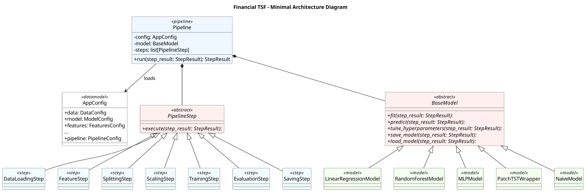

# Comparative Analysis of Model and Feature Complexity in Financial Time Series Forecasting

Codebase for the bachelor thesis by Florian Ullmann (THWS).

The project investigates whether increasingly complex deep learning models actually outperform simpler classical models in financial time series forecasting, or whether well-engineered features may bridge the gap. Models from linear regression to transformer architectures are compared across different levels of feature complexity using intraday stock data.


## Setup

Requires **Python >= 3.12** and [Poetry](https://python-poetry.org/).

```bash
poetry install
```

**PyTorch** must be installed separately into the Poetry environment:

```bash
# With CUDA (GPU):
poetry run pip install torch torchvision --index-url https://download.pytorch.org/whl/cu130

# CPU only:
poetry run pip install torch torchvision
```

**TA-Lib** requires the native C library to be installed on your system before `poetry install`. It can be possible that it is missing on your system -> see the [TA-Lib installation guide](https://github.com/TA-Lib/ta-lib-python#installation).

**PyPortfolioOpt** could not be installed reliably via Poetry, so it has to be installed manually:

```bash
poetry run pip install PyPortfolioOpt
```

---

## Running

```bash
poetry run python main.py
```

Results are saved to the `results/` directory with a timestamped subfolder per executed run.

## Data

The dataset used in the thesis (5-minute OHLCV data of the Nasdaq-100 constituents from Alpha Vantage) is not included in this repository, because the data provider's terms do not allow redistribution.

It can be requested again with your own Alpha Vantage API key (a premium key is required for historical intraday data). Set the key in a `.env` file in the project root:

```
ALPHAVANTAGE_API_KEY=your_key
```

The download code is located in [`financial_TSF/data/data_aquisition/ohlc_data.py`](financial_TSF/data/data_aquisition/ohlc_data.py). The data should then be placed inside the project root directory with the following structure:

```
data/
├── raw/
├── concatenated/
```

---

## Project Structure



---

## Pipeline

The experiment is executed as a sequential, config-driven pipeline. Each step receives and returns a shared `StepResult` context object.

| Step | Description |
|---|---|
| `DataLoadingStep` | Loads per-ticker intraday (5-min) OHLCV CSVs, filters by date range, validates data integrity |
| `FeatureStep` | Computes technical indicators (SMA, EMA, RSI, …)  controlled by `feature_config.json` and complexity levels |
| `SplittingStep` | Global timestamp-based train/val/test split (75/15/10) across all tickers to prevent look-ahead bias |
| `NormalizingStep` | Winsorization (clipping outliers at training-set percentiles) followed by RobustScaler, fit only on train data |
| `TrainingStep` | Executes the configured model's `fit()` and `predict()` methods on training/val/test sets |
| `EvaluationStep` | Unscales predictions, maps results back to individual tickers, computes MAE/RMSE and economic eval |
| `SavingStep` | Persists model, configs, metrics (JSON + CSV), predictions, and a run summary |

---

## Models

| Key in config.json | Model |
|---|---|
| `LinearRegression` | Scikit-learn Linear Regression |
| `RF` | Random Forest Regressor |
| `MLP` | Multi-Layer Perceptron (PyTorch) |
| `PatchTST` | Patch Time Series Transformer (PyTorch) |
| `Constant` | Constant Predictor |
| `Naive` | Naive Predictor |

---

## Feature Complexity Levels

Features are assigned a complexity level in `feature_config.json`. The `complexity_levels` config key controls which features are included in a run:

- **Level 10** — Basic trend indicators (e.g. SMA)
- **Level 20** — Extended trend indicators (e.g. EMA)
- **Level 30** — Momentum, volatility, volume indicators (e.g. RSI, ADX, MACD, Bollinger Bands)

---

## Configuration

All experiment parameters are set in [`financial_TSF/config.json`](financial_TSF/config.json). To change the experimental setup, it should be enough to edit this file.

Each saved result folder contains a copy of both config files for full reproducibility.

---

## License

© 2026 Florian Ullmann. All rights reserved. This applies to the source code and the thesis document. Please contact the author for any reuse.

---
